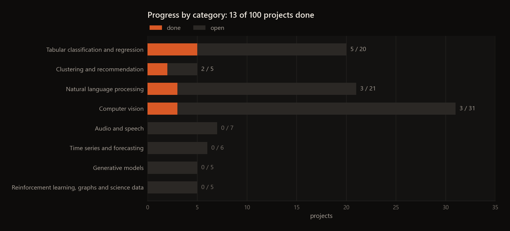

# 100 Data Science and ML Projects

**A checklist of 100 data science and machine learning projects, each with a dataset or tutorial to start from, and how far I've got through it.**

I put this list together as a path through the standard data science and machine learning projects, from Iris and
Titanic up to language models and reinforcement learning. Every row points to a dataset or tutorial to start from, and
the ones I've finished link to the repo with my solution. The numbers are the original order of the list; the
grouping into eight categories is only there to make it easier to scan.

To track your own progress, fork the repo and change `open` to `done` in the last column. `python scripts/make_figures.py`
redraws the chart above from the tables.

---

## Contents

[Tabular classification and regression](#tabular-classification-and-regression) ·
[Clustering and recommendation](#clustering-and-recommendation) ·
[Natural language processing](#natural-language-processing) ·
[Computer vision](#computer-vision) ·
[Audio and speech](#audio-and-speech) ·
[Time series and forecasting](#time-series-and-forecasting) ·
[Generative models](#generative-models) ·
[Reinforcement learning, graphs and science data](#reinforcement-learning-graphs-and-science-data) ·
[Beyond the list](#beyond-the-list) ·
[Link check](#link-check)

## Tabular classification and regression

5 of 20 done.

| # | Project | Dataset or reference | Status |
|--:|---|---|---|
| 1 | [Iris Flower Classification](https://github.com/EllE961/Iris-Flower-Classification) | [Iris Dataset (Kaggle)](https://www.kaggle.com/datasets/uciml/iris) | done |
| 2 | [Titanic Survival Prediction](https://github.com/EllE961/Titanic-Survival-Prediction) | [Titanic (Kaggle)](https://www.kaggle.com/c/titanic) | done |
| 5 | [Detecting Parkinson's Disease](https://github.com/EllE961/Parkinson-s-Disease-Kaggle) | [Parkinson's Disease Data Set (Kaggle)](https://www.kaggle.com/datasets/vikasukani/parkinsons-disease-data-set/data) | done |
| 7 | [Loan Prediction (Classification)](https://github.com/EllE961/Loan-Prediction) | [Analytics Vidhya Loan Prediction (Kaggle)](https://www.kaggle.com/datasets/anmolkumar/analytics-vidhya-loan-prediction/data) | done |
| 8 | House Price Prediction (Regression) | [House Prices (Kaggle)](https://www.kaggle.com/c/house-prices-advanced-regression-techniques) | done |
| 15 | Breast Cancer Detection | [Breast Cancer Wisconsin (Kaggle)](https://www.kaggle.com/uciml/breast-cancer-wisconsin-data) | open |
| 16 | Diabetes Prediction | [Pima Indians Diabetes (OpenML)](https://www.openml.org/d/37) | open |
| 25 | Credit Card Fraud Detection | [Credit Card Fraud (Kaggle)](https://www.kaggle.com/mlg-ulb/creditcardfraud) | open |
| 26 | HR Analytics (Employee Attrition) | [HR Analytics (Kaggle)](https://www.kaggle.com/pavansubhasht/ibm-hr-analytics-attrition-dataset) | open |
| 31 | Crop Recommendation | [Crop Recommendation (Kaggle)](https://www.kaggle.com/atharvaingle/crop-recommendation-dataset) | open |
| 41 | Car Price Prediction | [Car Price (Kaggle)](https://www.kaggle.com/datasets/hellbuoy/car-price-prediction) | open |
| 49 | Customer Churn Prediction | [Telco Customer Churn (Kaggle)](https://www.kaggle.com/blastchar/telco-customer-churn) | open |
| 53 | AirBnB Price Prediction | [AirBnB NYC (Kaggle)](https://www.kaggle.com/dgomonov/new-york-city-airbnb-open-data) | open |
| 58 | Ad Click Prediction (CTR) | [Avazu Click-Through (Kaggle)](https://www.kaggle.com/c/avazu-ctr-prediction) | open |
| 61 | Anomaly Detection (Network Intrusion) | [NSL-KDD (UNB)](https://www.unb.ca/cic/datasets/nsl.html) | open |
| 71 | Malware Detection (Static Analysis) | [Microsoft Malware (Kaggle)](https://www.kaggle.com/c/microsoft-malware-prediction) | open |
| 75 | Crop Yield Prediction (Geospatial) | [Kaggle search: crop yield geospatial](https://www.kaggle.com/search?q=crop+yield+geospatial) | open |
| 84 | Pricing Strategy (Regression + Web Scraping) | Scraped e-commerce data or a Kaggle price dataset | open |
| 93 | Customer Lifetime Value Prediction | A Kaggle CLV dataset or your own e-commerce data | open |
| 97 | Mortgage/Loan Default Risk Analysis | [Lending Club Data (Kaggle)](https://www.kaggle.com/wordsforthewise/lending-club) | open |

## Clustering and recommendation

2 of 5 done.

| # | Project | Dataset or reference | Status |
|--:|---|---|---|
| 10 | [Movie Recommendation System](https://github.com/EllE961/Movie-Recommendation-System) | [MovieLens Dataset](https://grouplens.org/datasets/movielens/) | done |
| 11 | [Customer Segmentation (Clustering)](https://github.com/EllE961/Mall-Customer-Segmentation-Data-KMeans) | [Mall Customer Segmentation (Kaggle)](https://www.kaggle.com/datasets/vjchoudhary7/customer-segmentation-tutorial-in-python) | done |
| 27 | Recommendation System (Books) | [Book-Crossing Dataset (Kaggle)](https://www.kaggle.com/datasets/ruchi798/bookcrossing-dataset) | open |
| 39 | NLP-based Movie Recommender (Plot Summaries) | [CMU Movie Summary Corpus](http://www.cs.cmu.edu/~ark/personas/) | open |
| 42 | Anime Recommendation System | [Anime (Kaggle)](https://www.kaggle.com/CooperUnion/anime-recommendations-database) | open |

## Natural language processing

3 of 21 done.

| # | Project | Dataset or reference | Status |
|--:|---|---|---|
| 3 | [Sentiment Analysis (Amazon Reviews)](https://github.com/EllE961/Amazon-Fine-Food-Reviews) | [Amazon Fine Food Reviews (Kaggle)](https://www.kaggle.com/datasets/snap/amazon-fine-food-reviews) | done |
| 4 | [Fake News Detection](https://github.com/EllE961/Fake-News-Detection) | [Fake News Dataset (Kaggle)](https://www.kaggle.com/datasets/clmentbisaillon/fake-and-real-news-dataset) | done |
| 12 | [Spam Email Detection](https://github.com/EllE961/Spam-Email-Detection) | [SMS Spam Collection (Kaggle)](https://www.kaggle.com/uciml/sms-spam-collection-dataset) | done |
| 21 | Named Entity Recognition (NLP) | [Annotated Corpus for NER (Kaggle)](https://www.kaggle.com/abhinavwalia95/entity-annotated-corpus) | open |
| 22 | Text Summarization | [News Summary Data (Kaggle)](https://www.kaggle.com/sunnysai12345/news-summary) | open |
| 29 | Personality Prediction from Text | [MBTI Kaggle Dataset](https://www.kaggle.com/datasnaek/mbti-type) | open |
| 32 | Named Entity Linking for News | [AIDA CoNLL-YAGO entity linking (MPI)](https://www.mpi-inf.mpg.de/departments/databases-and-information-systems/research/ambiverse-nlu/aida/downloads) | open |
| 34 | Text Translation (Seq2Seq) | [WMT English-German](https://www.statmt.org/wmt19/translation-task.html) | open |
| 44 | NLP Toxic Comment Classification | [Toxic Comments (Kaggle)](https://www.kaggle.com/c/jigsaw-toxic-comment-classification-challenge) | open |
| 46 | Emotion Detection in Text | [Emotion (Hugging Face)](https://huggingface.co/datasets/dair-ai/emotion) | open |
| 48 | Language Model (GPT-style) | [WikiText-103 (Hugging Face)](https://huggingface.co/datasets/Salesforce/wikitext), [OpenWebText](https://skylion007.github.io/OpenWebTextCorpus/) | open |
| 51 | Question Answering (SQuAD) | [SQuAD Dataset](https://rajpurkar.github.io/SQuAD-explorer/) | open |
| 55 | Sentiment Analysis (Twitter) | [Twitter US Airlines (Kaggle)](https://www.kaggle.com/crowdflower/twitter-airline-sentiment) | open |
| 64 | Yelp Review Sentiment Classification | [Yelp Dataset (Kaggle)](https://www.kaggle.com/yelp-dataset/yelp-dataset) | open |
| 70 | PDF Invoice Parsing (OCR + NLP) | Any invoice or receipt dataset on Kaggle | open |
| 74 | Financial Sentiment (News + Stocks) | [Financial PhraseBank (Kaggle)](https://www.kaggle.com/ankurzing/sentiment-analysis-for-financial-news) | open |
| 76 | Twitter Bot Detection | Botometer and the Twitter bot datasets in research repos | open |
| 80 | YouTube Comment Spam Detection | [YouTube Spam Collection (UCI)](https://archive.ics.uci.edu/ml/datasets/YouTube+Spam+Collection) | open |
| 86 | Resume Screening (NLP) | spaCy or NLTK; search Kaggle for a resume dataset | open |
| 96 | Automated Essay Scoring | [ASAP Automated Essay Scoring (Kaggle)](https://www.kaggle.com/c/asap-aes) | open |
| 99 | Keyword Extraction from Documents | BERT / KeyBERT; search for a keyword extraction dataset | open |

## Computer vision

3 of 31 done.

| # | Project | Dataset or reference | Status |
|--:|---|---|---|
| 6 | [Color Detection (OpenCV)](https://github.com/EllE961/Color-Detection) | [Multiple color detection with OpenCV (GeeksforGeeks)](https://www.geeksforgeeks.org/multiple-color-detection-in-real-time-using-python-opencv/) | done |
| 9 | [MNIST Digit Classification](https://github.com/EllE961/Digit-Recognizer-Application) | [Digit Recognizer / MNIST (Kaggle)](https://www.kaggle.com/c/digit-recognizer) | done |
| 13 | [Face Mask Detection (OpenCV & DL)](https://github.com/EllE961/Face-Mask-Detection) | [Face Mask Detection (Kaggle)](https://www.kaggle.com/datasets/andrewmvd/face-mask-detection) | done |
| 14 | Handwritten Equation Solver (OCR) | OCR with OpenCV and Python | open |
| 19 | Object Detection (YOLO/OpenCV) | [YOLOv5](https://github.com/ultralytics/yolov5) | open |
| 20 | Dog vs. Cat Image Classification | [Dogs vs. Cats (Kaggle)](https://www.kaggle.com/c/dogs-vs-cats) | open |
| 24 | Image Captioning | [Flickr8k (Kaggle)](https://www.kaggle.com/datasets/adityajn105/flickr8k) | open |
| 30 | Fire Detection in Images | [Fire Dataset (Kaggle)](https://www.kaggle.com/datasets/phylake1337/fire-dataset) | open |
| 33 | Image Super Resolution | [DIV2K](https://data.vision.ee.ethz.ch/cvl/DIV2K/) | open |
| 35 | Pose Estimation (OpenPose) | [COCO Keypoints](https://cocodataset.org/#keypoints-2018) | open |
| 37 | Leaf Disease Detection | [PlantVillage (Kaggle)](https://www.kaggle.com/emmarex/plantdisease) | open |
| 40 | Fruit Quality Detection (Computer Vision) | [Fruits 360 (Kaggle)](https://www.kaggle.com/moltean/fruits) | open |
| 43 | Facial Expression Detection | [FER 2013 (Kaggle)](https://www.kaggle.com/msambare/fer2013) | open |
| 45 | Satellite Image Classification | [EuroSAT (GitHub)](https://github.com/phelber/EuroSAT) | open |
| 47 | Brain Tumor Segmentation (Medical Imaging) | [Brain MRI Segmentation (Kaggle)](https://www.kaggle.com/mateuszbuda/lgg-mri-segmentation) | open |
| 50 | Road Lane Detection (OpenCV) | [Lane Detection (Medium)](https://medium.com/@sdalia92/lane-detection-and-journey-27a221c1c571) | open |
| 56 | Brain Tumor Classification (Images) | [Brain Tumor Data (Kaggle)](https://www.kaggle.com/navoneel/brain-mri-images-for-brain-tumor-detection) | open |
| 57 | Food Classification (Vision) | [Food-101 (Kaggle)](https://www.kaggle.com/dansbecker/food-101) | open |
| 59 | Vehicle Number Plate Detection | [OpenCV number plate tutorials (Medium)](https://medium.com/@dpereira1984) | open |
| 62 | Sign Language Recognition | [Sign Language MNIST (Kaggle)](https://www.kaggle.com/datamunge/sign-language-mnist) | open |
| 63 | Gesture Control (OpenCV + Mediapipe) | [MediaPipe](https://github.com/google/mediapipe) | open |
| 65 | Handwriting Recognition (not MNIST) | [IAM lines (Hugging Face)](https://huggingface.co/datasets/Teklia/IAM-line), or synthetic handwriting | open |
| 73 | Adversarial Attacks & Defenses (Image) | [CIFAR-10 (Kaggle)](https://www.kaggle.com/c/cifar-10) with an FGSM tutorial | open |
| 81 | Sign Detection (Street Signs) | [GTSRB German Traffic Sign (Kaggle)](https://www.kaggle.com/datasets/meowmeowmeowmeowmeow/gtsrb-german-traffic-sign) | open |
| 83 | NFT Image Rarity & Classification | NFT image sets from OpenSea or your own scrape | open |
| 85 | Fashion MNIST Classification | [Fashion-MNIST (Kaggle)](https://www.kaggle.com/zalando-research/fashionmnist) | open |
| 88 | Self-Driving Car Simulator (Behavioral Cloning) | [Udacity self-driving car (GitHub)](https://github.com/udacity/self-driving-car) | open |
| 89 | Realtime Hand Pose & Gesture Control | MediaPipe and OpenCV tutorials | open |
| 91 | AR Object Placement (Markerless Tracking) | OpenCV with ArUco, or Vuforia | open |
| 92 | Drone/Quadcopter Object Tracking | OpenCV object tracking or Deep SORT | open |
| 98 | Multi-label Image Classification (Medical) | [CheXpert](https://stanfordmlgroup.github.io/competitions/chexpert/) or NIH Chest X-rays | open |

## Audio and speech

0 of 7 done.

| # | Project | Dataset or reference | Status |
|--:|---|---|---|
| 17 | Speech Emotion Recognition | [RAVDESS Audio (Kaggle)](https://www.kaggle.com/uwrfkaggler/ravdess-emotional-speech-audio) | open |
| 28 | Music Genre Classification | [GTZAN Music Genre (Kaggle)](https://www.kaggle.com/datasets/andradaolteanu/gtzan-dataset-music-genre-classification) | open |
| 52 | Speech Command Classification | [Speech Commands (Kaggle)](https://www.kaggle.com/c/tensorflow-speech-recognition-challenge) | open |
| 60 | Sound Classification (Urban Sounds) | [UrbanSound8K (Kaggle)](https://www.kaggle.com/chrisfilo/urbansound8k) | open |
| 72 | Speech-to-Text (ASR) | [LibriSpeech Dataset](https://www.openslr.org/12) | open |
| 94 | Voice-based Gender Detection | Gender Recognition by Voice (Kaggle) or another labelled audio set | open |
| 100 | Voice Recognition (Human vs. Animal vs. Bell) | UrbanSound8K plus your own recordings of animals and bells | open |

## Time series and forecasting

0 of 6 done.

| # | Project | Dataset or reference | Status |
|--:|---|---|---|
| 18 | Stock Price Prediction | [G-Research Crypto Forecasting (Kaggle)](https://www.kaggle.com/c/g-research-crypto-forecasting), or Yahoo Finance / Quandl prices | open |
| 23 | Time Series Forecasting (Air Quality) | [Air Quality (UCI)](https://archive.ics.uci.edu/ml/datasets/Air+Quality) | open |
| 36 | Weather Forecasting | [Historical Weather (Kaggle)](https://www.kaggle.com/selfishgene/historical-hourly-weather-data) | open |
| 38 | Solar Power Generation Forecast | [Solar Energy (Kaggle)](https://www.kaggle.com/dronio/SolarEnergy) | open |
| 67 | Earthquake Prediction (Time Series) | [Earthquake Data (Kaggle)](https://www.kaggle.com/c/LANL-Earthquake-Prediction) | open |
| 79 | Road Traffic Analysis (Time Series) | [Metro Interstate Traffic Volume (UCI)](https://archive.ics.uci.edu/dataset/492/metro+interstate+traffic+volume) | open |

## Generative models

0 of 5 done.

| # | Project | Dataset or reference | Status |
|--:|---|---|---|
| 54 | Music Generation (RNN) | [Maestro Dataset (Magenta)](https://magenta.tensorflow.org/datasets/maestro) | open |
| 69 | Poetry Generation (LSTM) | Poetry Foundation data or your own scrape | open |
| 77 | Image Style Transfer (GAN) | [Neural Style Transfer (PyTorch tutorial)](https://pytorch.org/tutorials/advanced/neural_style_tutorial.html) | open |
| 78 | Image Inpainting / Completion | [Places2](http://places2.csail.mit.edu/download.html) or your own images | open |
| 87 | Image-to-Image Translation (CycleGAN) | [CycleGAN (GitHub)](https://github.com/junyanz/CycleGAN) | open |

## Reinforcement learning, graphs and science data

0 of 5 done.

| # | Project | Dataset or reference | Status |
|--:|---|---|---|
| 66 | EEG Signal Classification (Brain Waves) | [EEG datasets (Kaggle)](https://www.kaggle.com/broach) | open |
| 68 | Graph Classification (NetworkX / PyG) | [Open Graph Benchmark](https://ogb.stanford.edu/) | open |
| 82 | DNA Sequence Classification (Bioinformatics) | Gene expression data from NCBI or Kaggle | open |
| 90 | Protein Structure Classification | ProteinNet, DeepMind's data references, or PDB | open |
| 95 | Reinforcement Learning CartPole | [Gymnasium (successor to OpenAI Gym)](https://gymnasium.farama.org/) | open |

## Beyond the list

Two projects I built that sit next to the list rather than on it:

- [CarDetection](https://github.com/EllE961/CarDetection) detects and tracks vehicles across user-defined zones with YOLO and OpenCV, close to #19.
- [real-time-face-recognition-system](https://github.com/EllE961/real-time-face-recognition-system) is a PyQt5 app for managing face images and running webcam face recognition.

## Link check

I requested all 85 links in the original list on 21 October 2026. 71 loaded, two Medium pages refused the automated
request (Medium blocks scripts, so I left them as they were), and 12 were dead: 9 Kaggle pages returned 404,
`gym.openai.com` and `marsyas.info` no longer respond, and the EleutherAI blog post is gone. I replaced those 12 with the
closest working source for the same dataset (rows 16, 28, 30, 32, 39, 45, 46, 48, 61, 65, 79 and 95). Row 81 pointed
at a GAN competition instead of the German traffic sign data and now links to GTSRB. A few labels were renamed to
match where their link actually goes, for example row 5 said Medium but links to Kaggle.

## License

MIT, see [LICENSE](LICENSE).
